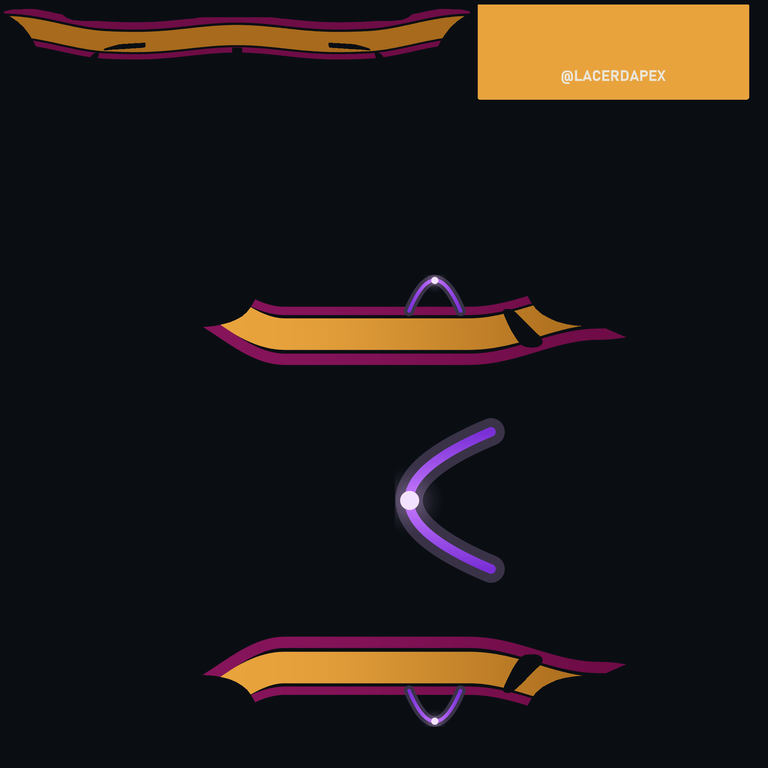
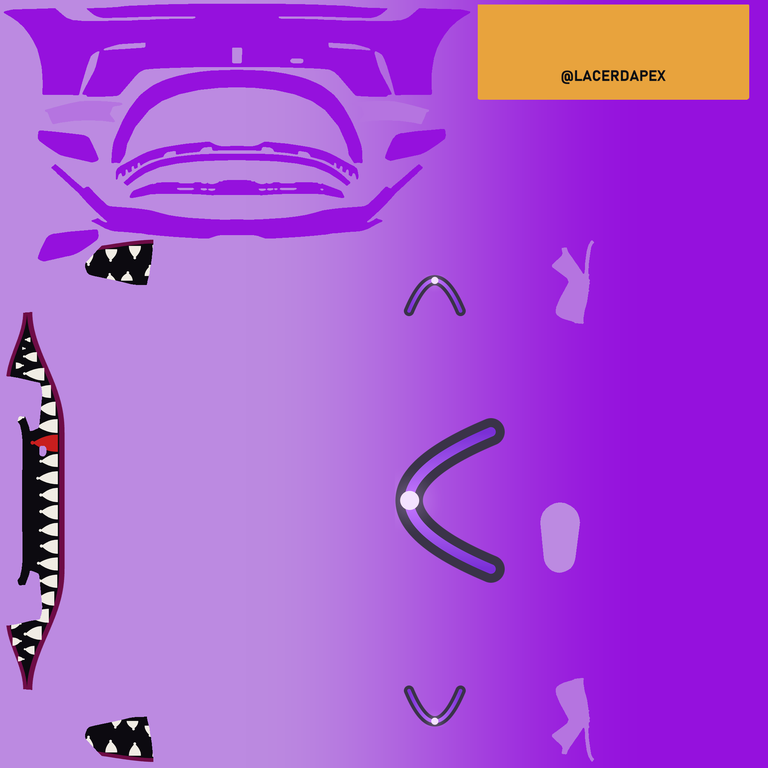
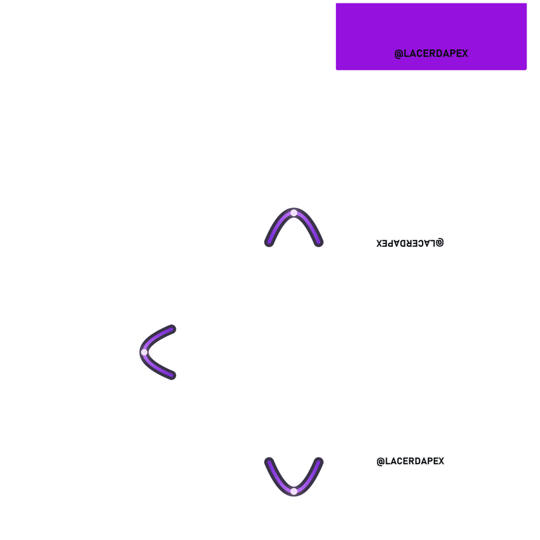

# claude-iracing-livery-skill

> Paint your iRacing car by talking to Claude. Describe the livery — colours, stripes, a shark
> mouth, your logo — look at the previews, say "install it", and it's in the sim. Calibrated per car,
> extensible without touching the plugin, 100% local: the official templates never leave your machine.

Built from the pipeline behind the [@lacerdapex](https://lacerdapex.explor8.ai) channel's own paints
([see the tools page](https://lacerdapex.explor8.ai/livery)). Sister project of
[claude-iracing-coach-skill](https://github.com/marcuslacerda/claude-iracing-coach-skill).

<p>



</p>

## Install

Prerequisite: [`uv`](https://docs.astral.sh/uv/getting-started/installation/) (`winget install astral-sh.uv`
on Windows; it fetches Python itself if you have none). Nothing else to install: the script declares its
own dependencies and `uv` resolves them the first time it runs.

**Claude Code** (recommended) — in a Claude Code session:

```
/plugin marketplace add marcuslacerda/claude-iracing-livery-skill
/plugin install iracing-livery@lacerdapex-livery
```

Desktop app: Code tab → **+** → Plugins → Add plugin, same repository. Details, PowerShell "from source"
steps and troubleshooting: [docs/install-claude-code.md](docs/install-claude-code.md).

**Claude Cowork** (alternative) — Customize → Plugins → Add → **Add marketplace** →
`marcuslacerda/claude-iracing-livery-skill`, then install *iRacing Livery*. It must run on the Windows
PC that has iRacing, since it writes into your `Documents/iRacing/paint` folder:
[docs/install-cowork.md](docs/install-cowork.md).

## Use it

Just talk to Claude:

> Set up iRacing painting for me

The `setup` skill asks a few questions once (your iRacing customer id, where your paint folder is,
where to keep your workspace, your wordmark/logo/colours) and tells you where to download the car's
template from iRacing. Then:

> Paint my Porsche Cup black satin with amber stripes and my logo on the roof

The `paint` skill picks a starter, renders it, shows you the previews, iterates with you, and copies
`car_<id>.tga` + `car_spec_<id>.tga` into the sim only when you say so. Open the Paint Shop
("Show Custom Paint") and it's there.

Three commands, or no command at all (the skills trigger from what you ask):

| Command | For |
|---|---|
| `/iracing-livery:paint` | design, tweak, preview, install a livery on a calibrated car |
| `/iracing-livery:calibrate` | a car the plugin doesn't know yet: test paint, your screenshots, a panel map |
| `/iracing-livery:setup` | first run, new PC, new customer id, moving the workspace, template download |

## What you can ask for

Starters (all parameters changeable by chat, no file needed) — full catalogue with every parameter,
variations and limits in [designs/README.md](designs/README.md):

| Starter | What you get | Say something like |
|---|---|---|
| `solid` | one body colour, accent mirrors/wing, logo on hood and doors, wordmark on the wing | "plain white with purple mirrors and my logo" |
| `two_tone` | two colours easing nose → tail, logo on the roof | "dark blue at the front fading to black" |
| `stripes` | three longitudinal stripes that dive into the fender and wrap the rear bumper | "black satin with an amber centre stripe" |
| `shark_mouth` | teeth and lips on the front bumper, dark intakes, two-tone body | "give it a shark mouth with red teeth" |
| `sponsor` | big logo on hood and doors, wordmark on wing and quarters, sill text band | "sponsor look: logo everywhere, 'POWERED BY X' on the sills" |

Elements the starters are built from, reusable in any design: `gradient`, `stripes`, `shark_mouth`,
`lockup`, `plate`, `flags`. Finish is a parameter everywhere: glossy, or satin body with glossy logos.

Cars:

| Car | CarPath | Status |
|---|---|---|
| Porsche 911 GT3 Cup (992.2) | `porsche9922cup` | ✅ calibrated: 43 islands named, 12 zones, shark mouth and rear-bumper wrap |
| Porsche 911 GT3 R (992) | `porsche992rgt3` | ⚠️ islands computed (36), panel map to fill with screenshots |
| Mazda MX-5 Cup (2016) | `mx5 mx52016` | ⚠️ islands computed (36), panel map to fill with screenshots |

A new car takes one calibration session with the `calibrate` skill ([docs/new-car.md](docs/new-car.md))
and is welcome back as a pull request.

## Your stuff stays yours

Everything you own lives in a **workspace** you choose during setup (default `~/.iracing-livery`, or a
OneDrive folder to continue on another PC):

```
brand.toml            your wordmark, logo, colours — every starter reads it
templates/<car>/      the PSD you downloaded from iRacing (never shared, never committed)
work/<car>/           exported layers, islands, renders (out/<design>/ with previews)
designs/<name>.py     your designs (a starter copy Claude edits for you)
lib/                  your own reusable pieces (a symbol drawn in code, a motif)
cars/<car>/           your own car calibrations (override the plugin's)
```

Workspace entries always win over the plugin's, and updating the plugin never touches them. No pull
request is needed to customise anything: [docs/extending.md](docs/extending.md).

## Run the pieces yourself

```bash
uv run scripts/paint.py status
uv run scripts/paint.py prepare --car porsche9922cup            # layers + islands from the PSD
uv run scripts/paint.py render --car porsche9922cup --design stripes --set body=#ffffff --set stripe=#1e3a8a
uv run scripts/paint.py render --car porsche9922cup --design stripes --deploy   # into the sim
uv run scripts/paint.py islandtest --car porsche992rgt3 --deploy # calibration paint for a new car
```

## What's in this repo

```
skills/paint, skills/calibrate, skills/setup   the three skills Claude loads (SKILL.md + references)
scripts/paint.py                                one CLI: prepare, islandtest, scaffold, render, compare ...
scripts/engine/                                 template layers, UV islands, rig (car.toml), spec map, TGA, drawing
scripts/engine/elements/                        gradient, stripes, shark_mouth, lockup, plate, flags
designs/                                        the starters + README catalogue
cars/<car>/                                     car.toml (calibration), panels.md, notes.md, islands.json, islands_map.png
docs/                                           lessons, new-car, extending, install guides, licensing
examples/                                       renders of the starters (illustration only)
```

## Scope

**In:** any car with an official PSD template; TGA + spec map; previews; installation into the sim;
per-car calibration; starters and elements; local extensibility.

**Out:** Trading Paints upload (do it with their client), car-specific decal packs, other sims,
anything that needs the network.

## License

MIT — see [LICENSE](LICENSE). Not affiliated with iRacing.com Motorsport Simulations. The paint
templates are iRacing's; this repository contains none of them and no third-party logos.
Details: [docs/licensing.md](docs/licensing.md).
