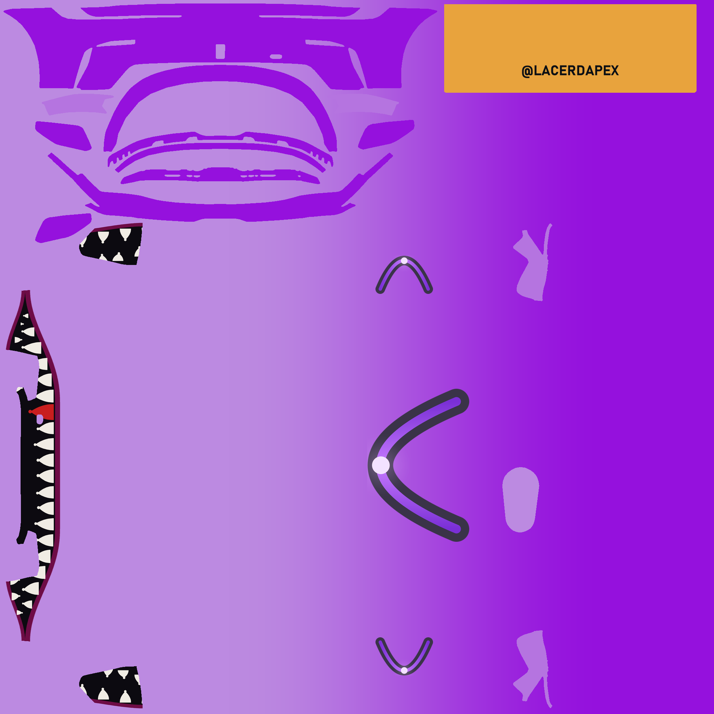
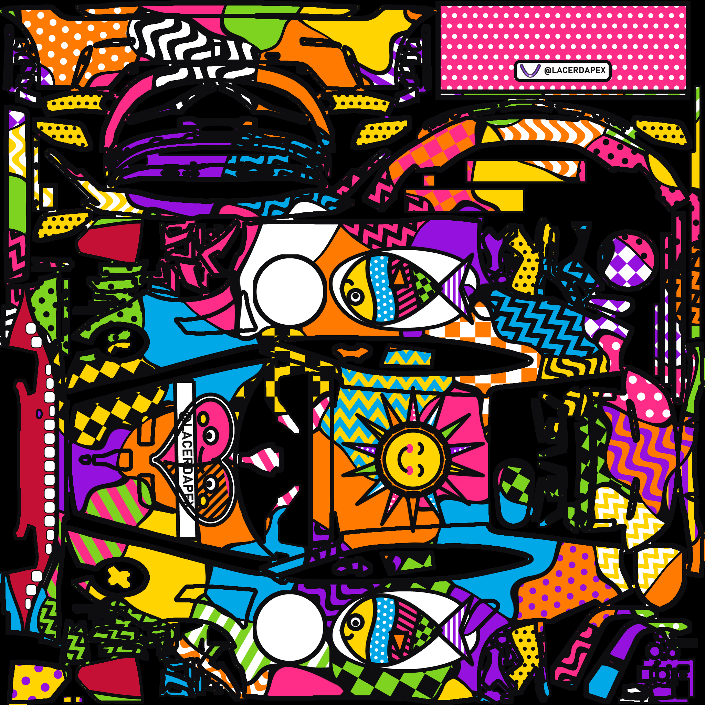
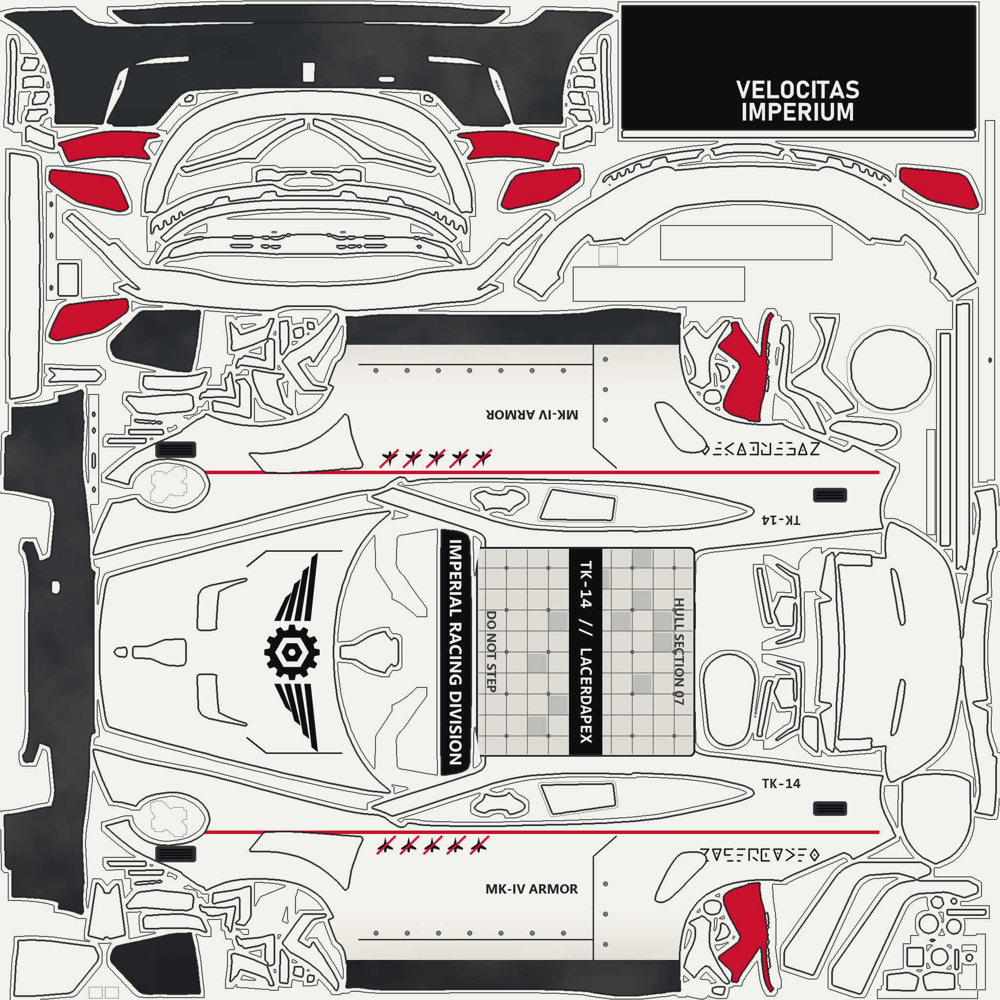
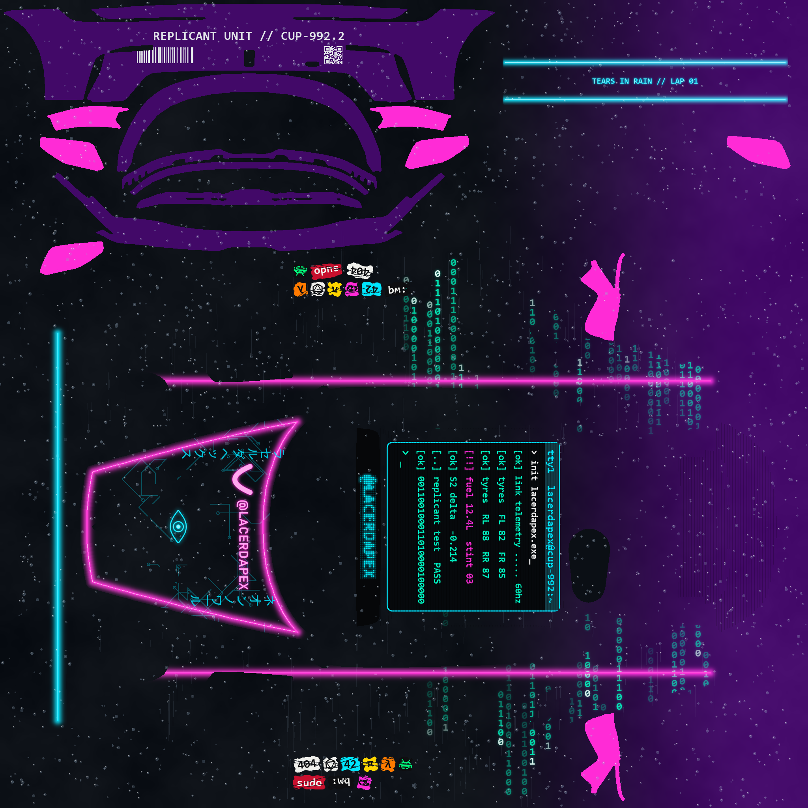

# Starters catalogue

Every starter is a small Python file with a `PARAMS` dict (what you can change by chat or with
`--set key=value`, no file needed), an optional `CAR`, and a `design(rig, p)` function that draws
on the car's calibrated rig. Claude reads this page before proposing one, so the variations listed
here are the ones it will offer first.

Conventions shared by all starters: a colour parameter is a hex string; an empty string (`""`) means
"take it from `brand.toml`" (your `[colors]`, `text`, `logo`); `satin = true` gives the satin body +
glossy logos finish that reads best in the sim; `logo_tint` paints the logo's shape in one colour;
when `brand.toml` has no logo, the wordmark text takes its place. Zones a car lacks are skipped, so
partially calibrated cars still render.

## The table (generated)

Regenerate with `uv run scripts/paint.py designs --doc` and paste between the markers; CI checks it.

<!-- generated:start -->
| Starter | Car | What it does | Parameters (default) |
|---|---|---|---|
| `imperial_cup` | porsche9922cup | Sci-fi armour: warm white panels with seams and bolts, gunmetal bumpers, winged gear insignia; variant=rebel is a rusty scrapyard ship (Porsche Cup). | `variant` = "imperial", `code` = "", `text` = "", `seed` = 3 |
| `neon_noir` | porsche9922cup | Cyberpunk neon noir: wet metallic graphite, binary code rain, magenta/cyan neon, roof terminal, nerd stickers; variant=day turns the neon off (Porsche Cup). | `variant` = "night", `code` = "", `katakana` = ["\u30cd\u30aa\u30f3\u30ce\u30ef\u30fc\u30eb", "\u30b5\u30a4\u30d0\u30fc\u30ec\u30fc\u30b5\u30fc"], `text` = "", `seed` = 5 |
| `pop_art_colorido` | porsche9922cup | Pop art in the spirit of Romero Britto: organic cells with thick black outlines, smiling heart, sun and fish (Porsche Cup). | `density` = "large", `seed` = 7, `text` = "" |
| `shark_mouth` | any calibrated | A shark mouth on the front bumper (lips, teeth, dark intakes) over a two-tone body, satin finish with glossy logos. | `nose` = "#bc8ae1", `tail` = "#9511dd", `mouth` = "#0c0a10", `lip` = "#6e0c46", `tooth` = "#f0ece4", `hook_tooth` = "#c81e1e", `teeth` = True, `accent` = "#e8a33d", `text` = "", `text_color` = "#0a0e13", `logo_tint` = "", `logo_height` = 400, `satin` = True |
| `solid` | any calibrated | One flat body colour, accent on mirrors/wing, the logo on the hood and doors, wordmark on the wing. | `body` = "#1a1a1a", `accent` = "#e8a33d", `text` = "", `text_color` = "#ffffff", `logo_tint` = "", `logo_height` = 300, `satin` = False |
| `sponsor` | any calibrated | The sponsor pack: big logo on the hood and doors, wordmark on the wing and rear quarters, a sill band with text. | `body` = "#ffffff", `accent` = "#9511dd", `logo_tint` = "", `logo_height` = 400, `text` = "", `text_color` = "#0a0e13", `sill_text` = "", `sill_band` = "#0a0e13", `sill_text_color` = "#ffffff", `satin` = False |
| `stripes` | any calibrated | Three longitudinal stripes that run the whole side, dive into the front fender and wrap the rear bumper; logo on the roof and doors. | `body` = "#0a0e13", `stripe` = "#e8a33d", `stripe_tail` = "#a86a1c", `outer` = "#86145a", `outer_tail` = "#6e0c46", `widths` = [22, 84, 30], `height` = 0.5, `dive` = True, `wrap_rear` = True, `accent` = "", `text` = "", `text_color` = "#e9e4d9", `logo_tint` = "", `logo_height` = 400, `satin` = True |
| `two_tone` | any calibrated | Two colours easing into each other from the nose to the tail, logo on the roof and doors, wordmark on the wing. | `nose` = "#bc8ae1", `tail` = "#9511dd", `blend_start` = 0.26, `blend_end` = 0.89, `accent` = "", `text` = "", `text_color` = "#e9e4d9", `logo_tint` = "", `logo_height` = 400, `satin` = False |
<!-- generated:end -->

## Starter sheets

### `solid`

One flat body colour; mirrors, wing and endplates in the accent colour; the logo on the hood and
(small) below the door handles; the wordmark on the wing.

- Zones: `hood`, `doors_low`, `wing_centre`; group `accent`.
- Try: `--set body=#ffffff accent=#9511dd` · `--set satin=true` · `--set logo_tint=#ffffff` on a dark body.
- Variations Claude knows: logo on the roof instead of the hood; no accent (`accent=`); bigger logo (`logo_height=400`).
- Limits: the number area on the doors is the sim's; detailed logos only below the handle line.

 

### `two_tone`

Two colours easing into each other from the nose (`nose`) to the tail (`tail`); the blend window is
`blend_start`..`blend_end` as fractions of the car length. Logo on the roof and below the handles,
wordmark on the wing.

- Zones: `roof`, `doors_low`, `wing_centre`; `[axes] length`.
- Try: `--set nose=#1e3a8a tail=#000000` · `--set blend_start=0.4 blend_end=0.7` (a sharper transition).
- Variations: reversed (dark nose, light tail); accent mirrors; tail parts follow the tail colour automatically (fixups).
- Limits: the gradient runs along the car only (no vertical fades: use `gradient.shade_sides` in a custom design).

 

### `stripes`

Three longitudinal stripes (outer / centre / outer) that run the whole side at `height`, dive into
the front fender (`dive`), climb again over the rear quarter and continue across the rear bumper
(`wrap_rear`). Each band fades from its nose colour to its tail colour. Satin finish by default.

- Zones: sides (`[sides]`), `[bumper_rear]` for the wrap, `roof`, `doors_low`, `wing_centre`.
- Try: `--set body=#ffffff stripe=#1e3a8a outer=#000000 outer_tail=#000000` · `--set widths=[10,120,10]` · `--set dive=false height=0.35`.
- Variations: a single wide band (`widths=[0,120,0]`); stripes that stop at the door (custom path knots in a copied design); the Cup-proven "wine outer, amber centre" (`outer=#86145a stripe=#e8a33d`).
- Limits: continuity across the louver island is calibrated per car (`louver_offset`); the wrap needs `[bumper_rear]`.

 

### `shark_mouth`

A shark mouth on the front bumper: a lens open at the centre and closed near the tyres, lips in
`lip`, interior `mouth` (the air intakes become the open mouth), teeth in `tooth` with a bigger one
in `hook_tooth` at the tow hook, the lower teeth continuing onto the intake walls. Over a two-tone
body (`nose` → `tail`), accent mirrors/wing, satin finish with glossy logos.

- Zones: `[mouth]` calibration (Porsche 992.2 Cup today), `roof`, `doors_low`, `wing_centre`.
- Try: `--set tooth=#e8a33d` (amber teeth) · `--set teeth=false` (lips only) · `--set nose=#0a0e13 tail=#0a0e13 lip=#c81e1e`.
- Variations: with stripes (copy and add `stripes.longitudinal`); logo on the hood instead of the roof; no accent.
- Limits: needs a car with `[mouth]` in car.toml; other cars raise a clear calibration error.

 

### `sponsor`

The sponsor pack: a big logo on the hood and the doors (big flat shapes survive the door-handle
recess), the wordmark on the wing and the rear quarters, and an optional sill band with text
(`sill_text`, kept between the wheels, clear of the louvers).

- Zones: `hood`, `doors`, `wing_centre`, `quarters`, sides for the sill band.
- Try: `--set sill_text="POWERED BY COFFEE"` · `--set body=#0a0e13 logo_tint=#ffffff text_color=#ffffff`.
- Variations: flags row on the front bumper (`flags.row` in a copied design); a world map or a plate behind the logo (`plate.with_plate`).
- Limits: sill text at 19 px is the minimum readable size; the sim draws the number over the front-lower door.

 

### `pop_art_colorido` (Porsche Cup)

Pop art in the spirit of Romero Britto (original art): the whole car cut into organic cells (a warped
Voronoi) with thick black outlines, also along every panel seam; each cell a flat saturated colour or a
pattern (stripes, dots, checks, zigzag, waves), never the same as its neighbours. Signature pieces: a
smiling heart on a white balloon in the free part of the hood (tip in the gap between the vents) with a
wordmark band, a segmented sun on the roof, a segmented fish on a white bubble behind each door, a smile
with straight rounded teeth on the front bumper, a pink dotted wing with the logo plate, yellow dotted
mirrors/endplates and a clean white circle under the sim's number. Glossy lacquer (roughness 25).

- Example: [`examples/porsche9922cup/pop-art-colorido/`](../examples/porsche9922cup/pop-art-colorido/prompt.md).
- Try: `--set density=small` (smaller, more chaotic cells) · `--set seed=11` (another cell draw).
- Limits: Porsche Cup coordinates (hood vents, door, number circle); `[mouth]` for the smile.

 

### `imperial_cup` (Porsche Cup)

An empire's racing team in an alternate universe (original insignia, no official logos): warm armour
white with thin panel seams, bolts, vents and stencils; gunmetal lower bumpers and sills with dust and
soot; a thin red belt-line stripe; a winged hex-gear insignia on the hood; a hull-panel grid on the roof
with `<code> // <WORDMARK>`; the wordmark in an invented geometric alphabet (A-Z, 0-9) on the rear
quarters; kill marks under the window; black wing with "VELOCITAS IMPERIUM"; red mirrors/endplates.
`variant=rebel` turns it into a scrapyard ship: dirty off-white, orange stripes, patched panels, rust,
burn marks, a cracked orange insignia, matte overall.

- Examples: [`imperial-cup`](../examples/porsche9922cup/imperial-cup/prompt.md) ·
  [`rebel-scrapyard`](../examples/porsche9922cup/rebel-scrapyard/prompt.md).
- Try: `--set variant=rebel` · `--set code=XR-77` (unit code on the roof and the quarter).
- Limits: Porsche Cup coordinates (door seams, quarter, under-window band).

 

### `neon_noir` (Porsche Cup)

Rainy neon-noir cyberpunk (original art): wet, slightly metallic graphite easing into deep purple; binary
code rain down the sides (the ASCII bits of `code`, default the wordmark), denser from the door back and
clear of the number; magenta neon on the belt line and around the hood, cyan on the front bumper and the
wing; the logo + wordmark as a neon sign on the hood with two katakana columns, a printed circuit and a
geometric eye between the vents; a roof terminal with a fake telemetry log; worn nerd stickers under the
number; barcode + QR + "REPLICANT UNIT // CUP-992.2" on the rear bumper; an LED-display windshield banner;
rain drops, streaks and scanlines. Body metallic 120 / roughness 40 (uses `Paint.metallic`).

- Example: [`examples/porsche9922cup/neon-noir-2049/`](../examples/porsche9922cup/neon-noir-2049/prompt.md).
- Try: `--set variant=day` (concrete body, neon off) · `--set "code=24 10.08.2026"` (car number + first win) ·
  `--set 'katakana=["ネオンノワール", "サイバーレーサー"]'`.
- Limits: Porsche Cup coordinates; the katakana needs a Japanese system font (MS Gothic / Yu Gothic / Meiryo).

 

## Elements reference (`scripts/engine/elements/`)

| Element | Signature | Needs in car.toml | Used by |
|---|---|---|---|
| `gradient.solid(rig, color)` | → float base | – | solid, stripes, sponsor |
| `gradient.two_stop(rig, c0, c1, start=0.26, end=0.89)` | → base | `[axes] length` | two_tone, shark_mouth |
| `gradient.three_stop(rig, c0, c1, c2, first, second)` | → base | `[axes]` | – |
| `gradient.shade_sides(rig, base, floor=0.78, span=0.22)` | darker toward the sill | `[sides]` | – |
| `gradient.paint_islands(rig, base, targets, color)` | flat colour on islands / groups | `[islands]`, `[groups]` | all (accent) |
| `stripes.smooth_path(knots)` / `trio(path, colors, widths, offsets)` / `longitudinal(rig, canvas, bands, fade)` | stripes on both sides | `[sides]` | stripes |
| `stripes.rear_bumper_wrap(rig, canvas, bands, h_end=0.22, ...)` | continue across the rear bumper | `[bumper_rear]` | stripes |
| `shark_mouth.draw(rig, paint, dark, lip, tooth, hook_tooth, wall_body, teeth)` | the mouth + intake walls | `[mouth]` (+ `[mouth.walls]`) | shark_mouth |
| `lockup.horizontal(mark, text, height, ...)` / `stacked(...)` | logo + wordmark sprite | – | pop_art_colorido, neon_noir |
| `plate.rounded_plate(size, radius, color)` / `with_plate(sprite, pad, radius, color)` / `framed` | plates behind sprites | – | – |
| `flags.draw_flag(code, w, h)` / `row(codes)` | simplified flags (BR MX CO US AR DE IT FR GB ES PT NL JP) | – | – |

Golden rules the elements respect: curves are drawn at 4x and downsampled; stripes are polygon
bands (no joint spikes); art on the sides is clipped onto the louver islands with the car's offset;
the mouth stays inside its island; nothing is ever placed outside the paintable area.

## How a new design is born

1. `paint.py new-design <name> --from <starter>` copies the starter into `<workspace>/designs/`.
2. Claude edits `PARAMS` and `design()` for you; your own pieces go in `<workspace>/lib/`.
3. `paint.py render --car <car> --design <name>`; look at `preview_*.png`; iterate; `--deploy`.

See [docs/extending.md](../docs/extending.md).

## Glossary

- **Template**: iRacing's PSD for a car (2048×2048), downloaded by you. **Layers**: the PNGs exported from it.
- **Island**: one connected piece of the UV map (a panel, a mirror shell, an endplate…), numbered by size.
- **Zone**: a named place on the car where a sprite goes (centre, rotation, fit box), declared in car.toml.
- **Fixup**: an island whose UV position lies (tail parts near the nose) gets the colour sampled where it really is.
- **Spec map**: the second TGA: metallic (R), roughness (G: white matte, black mirror), clear coat (B), specular mask (A).
- **Satin / glossy**: roughness 140 on the body vs 33 on logos; **matte**: ~200.
- **Sprite**: an RGBA image with a transparent background (a logo, a text, a lockup).
